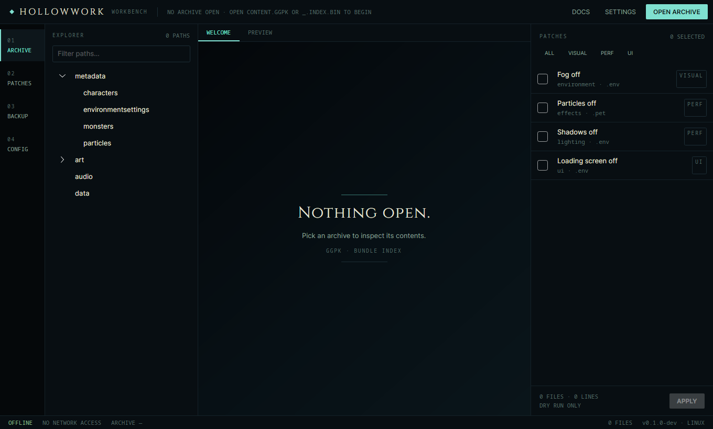

# Hollowwork

A cross-platform workbench for inspecting and modding Path of Exile client archives.



Hollowwork opens `Content.ggpk` and `_.index.bin`, lets you browse what is inside, and applies
declarative patches with a mandatory dry run and a verified backup. It works offline and never
touches the game process.

> Status: **M0 — scaffold**. The shell, archive detection and patch loader build and test on Linux
> and Windows. The patch engine and browser land in M1/M2 (see `docs/ROADMAP.md`).

## Why

Modding client assets should be reversible and boring:

- **Backup first.** Every write is preceded by a hash-verified copy of the archive.
- **Dry run always.** You see the exact files and lines a patch would touch before applying.
- **No network.** No update checks, no telemetry, no account. The app runs offline.
- **Data, not magic.** Patches are JSON files you can read, diff and write yourself.

## Features

- Open `Content.ggpk` (standalone) and `_.index.bin` (Steam bundles).
- Tree explorer with text and DDS preview.
- Declarative patch engine: replace, extension swap, boolean flags, block stripping.
- Path protection: keep chosen paths out of every patch.
- Backup and restore with SHA-256 manifests.
- Profiles per game.

Planned after v1: minimap colours, camera tweaks, MTX preview, currency helpers.
Automation of gameplay is **out of scope** for this project.

## Build

Requires the .NET 10 SDK.

```bash
dotnet restore
dotnet build -c Release
dotnet test
dotnet run --project src/Hollowwork.App
```

The app builds and runs on Linux (X11/Wayland) and Windows. macOS is untested.

## Layout

```
src/Hollowwork.App       Avalonia UI
src/Hollowwork.Core      archive access, patch execution, backup
src/Hollowwork.Patches   patch model, loader and validation
patches/poe1, patches/poe2
tests/
docs/
```

## Patch example

```json
{
  "id": "poe1.fog-off",
  "name": "Fog off",
  "description": "Disables the fog block inside environment settings.",
  "game": "poe1",
  "targets": [{ "root": "metadata/environmentsettings", "extensions": [".env"] }],
  "operations": [{ "type": "replace", "from": "fog", "to": "xog" }]
}
```

Format reference: `docs/PATCH-FORMAT.md`.

## Safety

- Hollowwork does not inject into, hook, or read the memory of the game.
- It only edits local archive files, and only after a backup.
- Modifying client assets may violate the game's Terms of Service. Use at your own risk.

## License

AGPL-3.0-or-later. See `LICENSE`.

The AGPL choice follows from the archive library dependency (`LibGGPK3`), which is AGPL-3.0.
