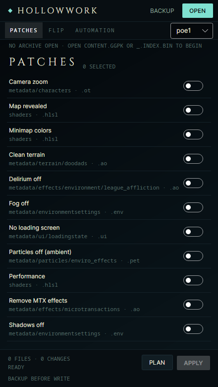
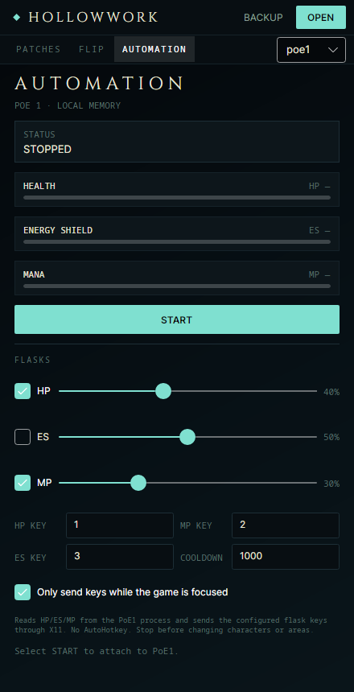
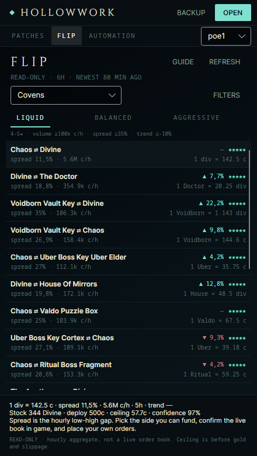

# Hollowwork

A cross-platform workbench for inspecting and modding Path of Exile client archives.



Hollowwork opens `Content.ggpk` and `_.index.bin`, lets you browse what is inside, and applies
declarative patches with a mandatory dry run and a verified backup. The archive and patch side is
local and offline; the optional FLIP tab uses the public market API, and the AUTOMATION tab reads
the game process only after you press START. The patch engine never touches the game process.

> Status: GGPK/Bundles2 browser, dry-run patch planner, applier, path protection and verified
> backup are implemented, with a shipped PoE1 patch set. FLIP (read-only market screener) and
> AUTOMATION (PoE1 auto-flask) are optional tabs.

## Why

Modding client assets should be reversible and boring:

- **Backup first.** Every write is preceded by a hash-verified copy of the archive.
- **Dry run always.** You see the exact files and lines a patch would touch before applying.
- **Offline by default.** No update checks, no telemetry, no account. Patches, browsing and
  backups work with no network. FLIP and AUTOMATION are explicit, opt-in tabs.
- **Data, not magic.** Patches are JSON files you can read, diff and write yourself.

## Features

- Open `Content.ggpk` (standalone) and `_.index.bin` / `Bundles2` (Steam).
- Bundles2 read and write on Linux and Windows, using a user-provided Oodle library
  (`docs/OODLE.md`); Proton is the fallback.
- Tree explorer with text and DDS preview.
- Declarative patch engine: literal replace, regex, extension swap, boolean flags, block
  stripping, line removal, explicit file allowlists and per-target operations.
- 11 shipped PoE1 patches: camera, minimap, terrain, Delirium, fog, loading screen, particles,
  MTX, shadows and a 15-shader performance patch.
- Path protection: keep chosen paths out of every patch.
- Backup and restore with SHA-256 manifests.
- Remembers the last archive, the selected game and every patch parameter between sessions.
- FLIP tab: read-only currency market screener with spread, volume, stock, trend and confidence.
  Three presets — **LIQUID**, **BALANCED**, **AGGRESSIVE** — plus a category filter
  (**currency / boss keys / cards / gems**), an in-app **GUIDE**, and hourly responses cached
  under `~/.local/share/Hollowwork/market`.
- AUTOMATION tab: PoE1 auto-flask on Linux/Proton. Reads HP/ES/MP from the game process and sends
  the configured HP/MP/ES flask keys through X11 XTest. It is separate from the patch engine and
  does not use AutoHotkey.

Planned next: PoE2 patch coverage, shared profiles, a global hotkey with a panic stop, and pausing
automation in town or while a zone loads. Order placement and trade bots are **out of scope**;
AUTOMATION is local, opt-in, and currently limited to auto-flask.

## Shipped patches (PoE1)

| Patch | Files | What it does |
|---|---|---|
| **Camera zoom** | `metadata/characters/character.ot` | Sets the zoom of the player camera node |
| **Map revealed** | minimap visibility shader | Raises the minimap visibility floor |
| **Minimap colors** | minimap blending shader | Recolors explored, edge and unexplored areas |
| **Clean terrain** | `metadata/terrain/doodads`, `.ao` | Strips doodad blocks that cost draw time |
| **Delirium off** | 2 roots, `.ao` | Strips Delirium environment blocks |
| **Fog off** | `metadata/environmentsettings`, `.env` | Disables the fog block |
| **No loading screen** | `metadata/ui/loadingstate`, `.ui` | Hides the loading widgets |
| **Particles off** | `.pet` in 2 roots | Empties environment particle effects |
| **Performance** | 15 shaders | Cuts post-processing, screen-space effects and lighting work |
| **Remove MTX effects** | `metadata/effects/microtransactions`, `.ao` | Strips cosmetic effect blocks |
| **Shadows off** | `metadata/environmentsettings`, `.env` | Sets `shadows_enabled` to false |

Every patch runs as a dry run first and lists the files and lines it would touch.

## AUTOMATION (PoE1, Linux)



The **AUTOMATION** tab reads HP/ES/MP directly from the PoE1 process and can press the configured
flask keys while the game window is focused. It never runs until you press **START**, and keys are
only sent while the game has focus (unless you disable that guard). No AutoHotkey.

Requirements:

- Path of Exile 1 running through Steam/Proton on X11 or XWayland.
- Hollowwork running as the same user that owns the game process (`process_vm_readv`).
- `DISPLAY` pointing at the session running the game.

The offset profile is `automation/poe1.json`: pattern, pointer chain and Life component offsets
for the current build. After a game patch, update that JSON. The reader validates the chain before
it starts and reports `GameRoot found, but the in-game player could not be resolved` while you are
still at login/character select.

Automation is gameplay automation and violates the game's terms; account restrictions are
possible. The current module only does auto-flask — no logout, skills, overlay or trade automation.

## Currency FLIP



Open the **FLIP** tab, pick a league and press **REFRESH**. The app reads the public
`web.poecdn.com/api/currency-exchange` aggregate for the last six hours, caches it locally and
ranks pairs by a conservative liquidity-adjusted score.

Use the presets to set the cuts: **LIQUID** (4–5★, ≥100k c/h, spread ≤35%), **BALANCED**
(4–5★, ≥25k c/h, spread ≤60%) and **AGGRESSIVE** (3+★, ≥5k c/h, spread ≤150%). **FILTERS**
narrows the pair category, and **GUIDE** explains the columns and the trade cycle.

The numbers are **estimates**, not a live order book: the API publishes an hourly aggregate about
five minutes after each hour. The tool never places orders and never touches the game process.
Confirm the current rate at Faustus in game before trading. The "ceiling" is capital × spread;
real fills capture only part of it.

## Build

Requires the .NET 10 SDK.

```bash
dotnet restore
dotnet build -c Release
dotnet test
dotnet run --project src/Hollowwork.App
```

The app builds and runs on Linux (X11/Wayland) and Windows. macOS is untested.

## Validate against a real archive

The repository ships a smoke tool that only reads by default. With `--apply` it writes the same
bytes back to one small file after a verified backup:

```bash
dotnet run --project src/Hollowwork.Smoke -- "/path/to/Content.ggpk"
dotnet run --project src/Hollowwork.Smoke -- "/path/to/Content.ggpk" --apply --backup ~/hollowwork-backups
```

The backup is a full copy of the archive, so make sure there is disk space.

## Layout

```
src/Hollowwork.App        Avalonia UI
src/Hollowwork.Automation PoE1 process memory and auto-flask engine
src/Hollowwork.Core       archive access, patch execution, backup, market data
src/Hollowwork.Patches    patch model, loader and validation
src/Hollowwork.Smoke      read/write smoke check for real archives
patches/poe1, patches/poe2
automation/poe1.json      PoE1 pattern, pointer chain and Life offsets
tests/
docs/
```

## Patch example

```json
{
  "id": "poe1.fog-off",
  "name": "Fog off",
  "description": "Disables the fog block inside environment settings.",
  "game": "poe1",
  "targets": [{ "root": "metadata/environmentsettings", "extensions": [".env"] }],
  "operations": [{ "type": "replace", "from": "\"fog\"", "to": "\"xog\"" }]
}
```

Format reference: `docs/PATCH-FORMAT.md`.
Coverage comparison against an external reference suite: `docs/PATCH-PARITY.md`.

## Safety

- The patch engine never injects into, hooks, or reads the memory of the game. It edits local
  archive files only, and only after a verified backup.
- The AUTOMATION tab reads HP/ES/MP from the game process with `process_vm_readv`, only after you
  press **START**, and sends keys through X11. Stop it before changing character or area.
- Modifying client assets or automating gameplay may violate the game's Terms of Service. Use at
  your own risk.

## License

AGPL-3.0-or-later. See `LICENSE`.

The AGPL choice follows from the archive library dependency (`LibGGPK3`), which is AGPL-3.0.
